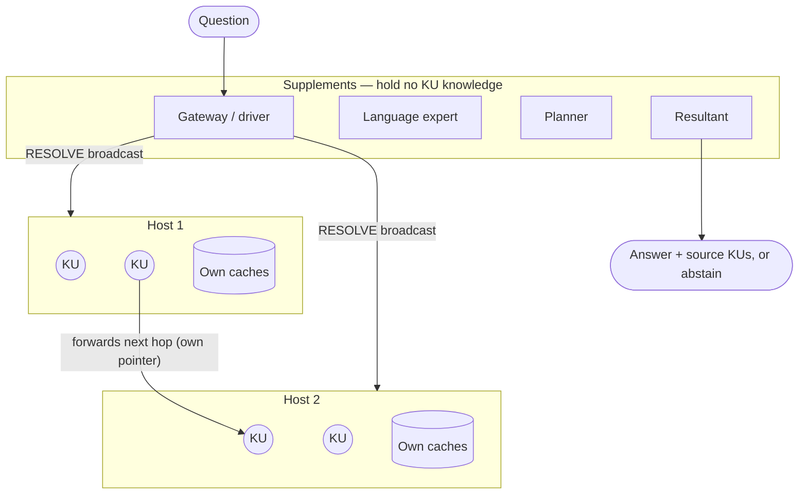
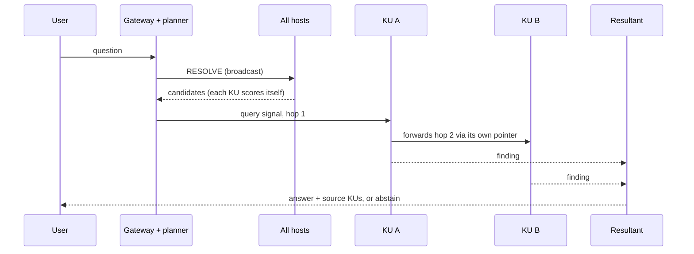

# NOG — knowledge units as neurons

**A CPU-first AI built from small, self-contained knowledge units (KUs)
that can be added and removed easily.**

NOG keeps knowledge in many tiny neural networks — one per document —
instead of inside one large model. Each knowledge unit (KU) is trained
only on its own document, holds what it learned in its own ~35–39k
parameters, and computes its own answers; after training, the text is
deleted. KUs are spread across hosts that divide the units and the work.
Because every fact lives in one small unit, it can be **found, forgotten
(delete the unit), edited (retrain that one unit) and traced**, without
touching anything else — on ordinary CPUs.

This is a research prototype, not a product. See *Limits* below.

## Architecture



## How a question is answered



More diagrams (inside a KU, failover, task batching): [docs/architecture.md](docs/architecture.md)

## Key results

All tests ran once, on fresh test sets, with every choice frozen on a
separate development set. *Control* = same pipeline answering with the
first fitting slot (or all fitting slots for sets). Raw text deleted in
every neuron run; answers identical with and without it.

| Test | Neurons | Comparison | Verdict |
|---|---|---|---|
| 2WikiMultiHopQA (2,000) | 39.7% | control 28.8% | beats control |
| MetaQA 2-hop (379) | 49.3% | control 5.8% | beats control |
| MetaQA 3-hop (1,621) | 13.5% | control 8.0% | beats control |
| MetaQA set answers (10,452) | 16.2% | all slots 4.3% | beats control |
| vs RAG, MetaQA (630) | 18.7% at ~0.07 s/q* | Qwen2.5-7B RAG 17.0% at 25–38 s/q | same accuracy, far faster |
| vs RAG, fictional companies (378) | 8.2% | Qwen2.5-7B RAG 31.2% | RAG better |
| Forgetting (300 companies) | 0 leaks, unrelated answers unchanged | — | pass |
| Updating (500 edits) | new fact live in ~1 s, neighbours unchanged | — | pass |
| Distribution | answers identical under live rebalancing, host failures, replicas | — | pass |

\*Neurons answered in batches; see [docs/results.md](docs/results.md)
for per-question latency, intervals and full details.

## Limits

- Less accurate than systems that read text (text-reading baseline: 58.7% on 2Wiki).
- Facts expressed only by document layout (e.g. dates in parentheses) are largely unlearnable when each KU learns only from its own text.
- The planner fails on question wordings it hasn't seen.
- Tested on template-style questions, on one machine.
- No authentication or encryption between hosts: trusted networks only.

## Quick start

```bash
uv venv --python 3.11 .venv
uv pip install --python .venv/bin/python --index-url https://download.pytorch.org/whl/cpu torch
uv pip install --python .venv/bin/python -e '.[dev]'
pytest
```

Reproduce a headline result: [docs/reproduce.md](docs/reproduce.md)

## Documents

[Paper](docs/paper.md) · [Results](docs/results.md) ·
[Architecture](docs/architecture.md) · [Reproduce](docs/reproduce.md)

## License

Code: AGPL-3.0-only; a commercial license is available from the owner.
Third-party data keep their own licenses ([docs/data.md](docs/data.md)).
Models trained on MetaQA are research artifacts (MovieLens/OMDb terms).
Contributions: see [CONTRIBUTING.md](CONTRIBUTING.md) (CLA required).

Developed with the assistance of AI tools (Anthropic's Claude); the
author directed the work and takes full responsibility for it.
