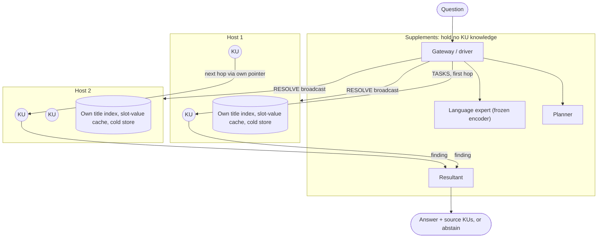
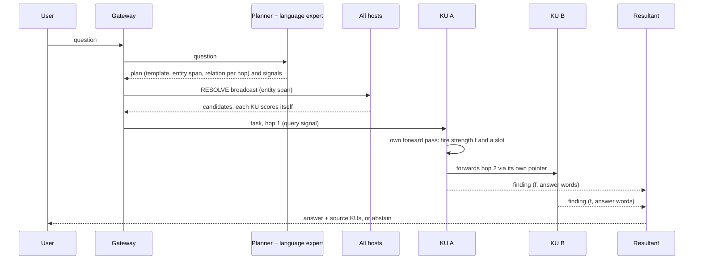
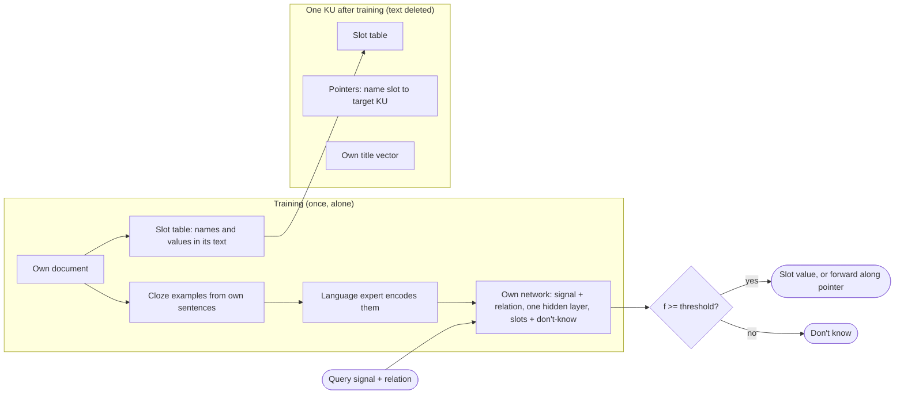
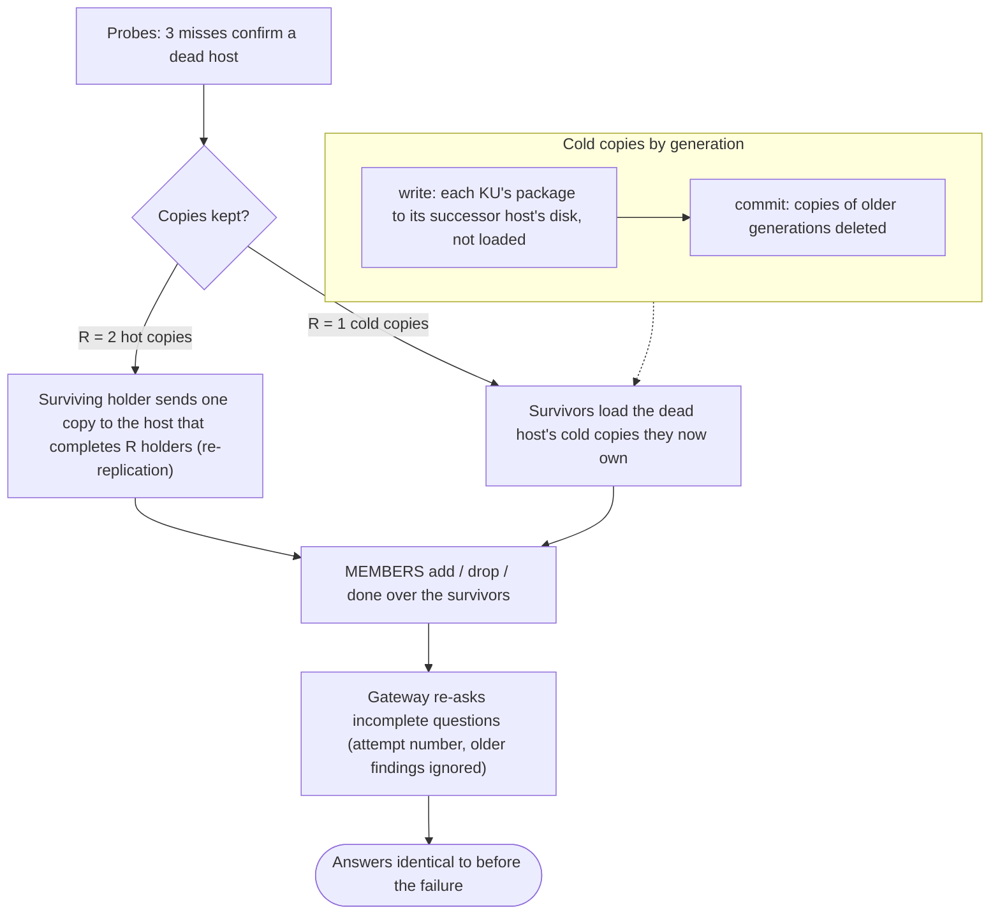
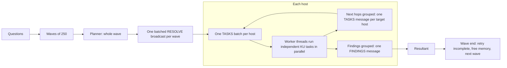

# NOG architecture

How the pieces fit, from the whole system down to one knowledge unit (KU). Code: `mxn/neuron/` (KU, host, gateway);
numbers and tests in [results.md](results.md), method in [paper.md](paper.md).

## 1. System overview

Each host holds only its own KUs, placed by rendezvous hashing over the host list, and builds its own index and caches
for them; no index or directory spans hosts. The supplements turn words into signals (planner, language expert) and
apply exact operations to the KUs' findings (resultant), but never read KU knowledge. After the first hop the gateway
does not orchestrate: KUs forward the next hop themselves.

## 2. Question flow

The planner breaks the question into a chain of relations; the language expert encodes the entity span and the
question into signals. The KU that wins RESOLVE answers the first relation with its own network; if its answer names
another KU, it sends the next hop to that KU along its own pointer (or a RESOLVE broadcast when it has none). The
resultant combines the findings with exact operations and abstains when a chain is incomplete or a KU says
"don't know" (f below its threshold).

## 3. Inside one KU

A KU is one small network (input: query signal plus relation; one hidden layer; outputs: one per own slot plus
"don't know"), trained only on its own document: about 35–39k parameters (2Wiki and corpus A headline runs). Its slot table holds
the names and values found in its own text; name slots that match another KU's title become its pointers, found by its
own RESOLVE broadcast. After training the text is deleted and an audit checks that no sentence remains in memory;
answers are identical with and without the text.

## 4. Failover: hot copies, cold copies and takeover

KUs are placed by rendezvous hashing; with R = 2 each KU is loaded on the first two hosts of its order, with R = 1 its
package (parameters, slots, pointers; never text) is kept as a cold copy on the next host's disk, written in numbered
generations. When probes confirm a death, the survivors take over the dead host's KUs (from a hot copy or by loading
cold copies) through the same MEMBERS phases as live rebalancing, and the gateway re-asks questions that went
incomplete; the tests require identical answers and no lost request. Primary/backup roles with epochs (a backup
promotes itself, epoch + 1) belong to the replication of the text-reading baseline (`mxn/expert/replica.py`); the
neuron system needs no roles, because every copy is the same package and answers bit-identically.

## 5. Spark-style batching

The driver sends questions in waves (default 250): one planner pass, one batched RESOLVE broadcast and one TASKS batch
per host per wave, like a Spark stage. Each host runs its KUs' independent tasks in parallel on worker threads and
groups what they produce, so next hops travel as one message per target host and findings as one message to the
resultant. This batching is why throughput is ~0.07 s per question on 5 host processes while one question alone
waits for its hops.
