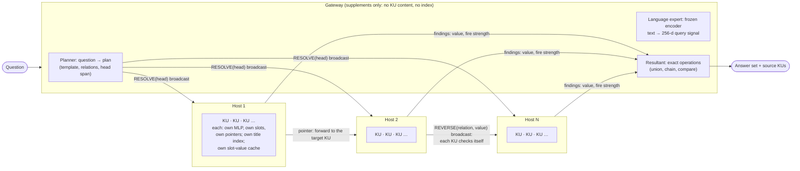
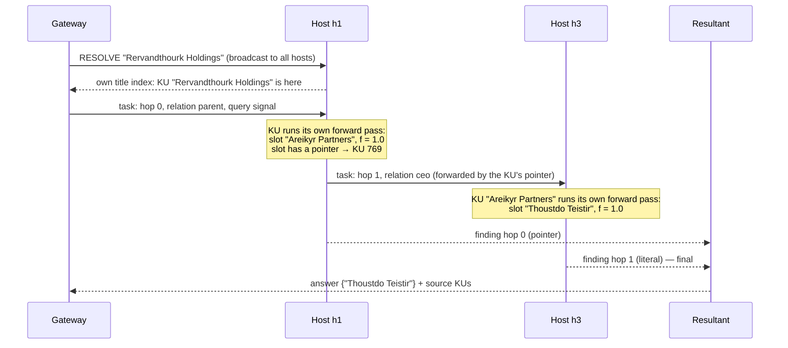

# Knowledge units as neurons: a distributed question-answering system whose knowledge can be forgotten, edited and audited

Draft v0.1 (2026-11-17), publication freeze. Every number is copied from [results.md](results.md), which gives its
interval, sample size, job, commit and log entry. Numbers on corpus A are on fictional companies (synthetic data
generated for this demo; any resemblance to real companies or people is unintended). Baselines are labelled
"baseline (not neurons)".

## Abstract

Large language models store facts inside billions of shared weights. A fact cannot be removed, corrected or traced to
its source without retraining or approximate editing. We test a different organisation: one small neural network per
document, which we call a knowledge unit (KU). Each KU is trained only on its own document, holds its knowledge in its
own parameters, and computes its own answers; after training, the document text is deleted and an audit confirms that
no sentence remains in memory. KUs are spread over host processes that divide both the units and the work. A question
is broken into a plan by a small planner; the plan is sent to the KUs, which answer and forward the question to each
other.

On three question-answering sets the KU system beats a matched control that picks the first fitting answer slot, on
fresh test sets with every choice frozen on a separate development set and one attempt per test: 2WikiMultiHopQA
39.70% vs 28.80% (n = 2,000); MetaQA 2-hop 49.34% vs 5.80% (n = 379) and 3-hop 13.45% vs 7.96% (n = 1,621); MetaQA
set questions 16.19% vs 4.28% (n = 10,452). It is not accurate: a text-reading system of our own reaches 58.65% on
the same 2Wiki questions, and the KU system reaches only 38–64% of its own oracle ceiling. On a fictional company corpus it
forgets 30, 150 or 300 companies with zero leaks, a clean memory audit within about 4 seconds, and every unrelated
answer unchanged; it applies 500 fact edits by retraining one unit each, with the new fact answerable about one second
after the edit and 99.2% of known facts switched. Against a retrieval-augmented baseline with 1.5B and 7B open models on
CPU, accuracy on MetaQA is comparable to the 7B model and better than the 1.5B model, at roughly 0.07 seconds per
question (batched) versus 25–38 seconds; on the fictional company corpus, where our planner fails unseen wordings, the
baseline is clearly better (7B 31.2% vs 8.2% on the same questions). We state the limits plainly: accuracy below text-reading systems, failure on
layout-only relations, a planner that does not generalise to unseen wordings, template questions, one machine, no
authentication.

## 1. Claim and principle

**Claim.** KUs are neurons. Each KU holds its knowledge in its own trained parameters, learned only from its own article,
and computes its own answers. The system is distributed: KUs are spread across many hosts, which divide both the KUs
and the work, in the style of Apache Spark.

**Principle.** KUs are the centre of the system. Everything else is a supplement that exists only to let KUs do their
own job: a language expert (words to signals and back), a planner (question to plan), a resultant (combines KU
findings with exact operations), and a gateway (entry point, spreads work over hosts). In every design step we asked
whether a supplement does work a KU could do itself; if so, the work moved to the KUs.

Two checks were applied to every design and rules commit:
- **Neuron check.** (1) The knowledge used to answer lives in the KU's own parameters; (2) the KU computes its own
  answer; (3) no shared component reads or interprets a KU's knowledge on its behalf; (4) training or changing a KU
  touches no other KU; (5) no supplement does work a KU could do.
- **Distribution check.** No central component holds KU state; no index spans hosts; owners are found by broadcast,
  never by a directory.

The point of the organisation is not accuracy. It is that knowledge has an address: each fact lives in one small unit
that can be found, deleted, retrained, copied and audited without touching the rest.

## 2. Architecture

**A KU** (one per document; 3,000–18,127 per corpus) has:
- an **answer-slot table** built from its own text by surface rules (dates, numbers, capitalised name spans);
- a **small MLP** (hidden size 128 in the final runs) that maps a query signal — the encoder's 256-d vector of the
  sub-question plus a relation code — to a distribution over its own slots and "none"; the fire strength is
  f = 1 − p(none);
- **pointers**: for each name slot, after training, the KU broadcasts a RESOLVE for that name once and stores the
  winning KU's id. Pointers let a question hop from KU to KU without a central index.

**Training** is self-supervised and local: the KU makes cloze variants of its own sentences (a slot masked, clause
order and relation-noun frames varied), encodes them with the shared frozen encoder, and learns variant → slot.
Nothing outside the document is read. After training the document text is deleted from every host; an audit scans
every live string in every host process and in the driver and must find zero sentences of any document.

**Answering.** The planner turns the question into a plan: a template (chain, reverse lookup, set), relations per hop
and the head span. The head is found by a RESOLVE broadcast: every host answers for its own KUs from its own title
index, and the gateway merges the replies. The query goes to the winning KU, which runs its own forward pass. If its
answer is a pointer, the KU forwards the next hop to the target KU itself; the gateway does not orchestrate hops.
**Reverse questions** ("which films did X direct?") have no head KU: the host broadcasts REVERSE(relation, value), and
every KU that holds the value in its slot table decides with its own forward pass whether it is a yes. A per-host
slot-value cache over that host's own KUs only proposes candidates (rebuildable, never spanning hosts); every candidate
still decides by itself. **Set answers** list every slot whose probability is at least θ_f times the top slot's
(θ_f chosen on dev). The resultant applies exact operations to the findings; it never reads KU content.

**Distribution.** KUs are placed on hosts by rendezvous hashing of their ids; hosts can join and leave while
questions run (KUs move with their parameters, slots and pointers, never text); cold copies (R = 1) or hot replicas
(R = 2) restore a dead host's KUs; locality placement moves KUs next to their most-used pointer targets. Each
mechanism passed a test that requires identical answers and zero lost requests (§5.6).

**A worked example** (corpus A dev; log 2026-11-17 "cost facts"). *"Who is the chief executive of the parent company
of Rervandthourk Holdings?"* The planner returns a chain plan: r1 = parent, r2 = ceo, head = "Rervandthourk Holdings".

The gateway never asks who the parent's CEO is; the first KU forwards the question along its own pointer. Neither KU
holds text at answer time. The fire strengths of correct answers are often low: on this question type 149 of 181 dev
answers are exact, but only 72 of them have both hops above f = 0.5 — which is why confidence (§6) is narrow.

**FORGET and EDIT.** FORGET is a broadcast: every host deletes the named KUs it holds (parameters, slots, package,
caches), removes them from its own title index, slot-value cache and cold store, and clears its own KUs' pointers to
them. There is no central list to edit. EDIT goes to the owning host: the KU retrains alone on its own edited document
with the same settings as the original training, rebuilds its slots, re-resolves its own pointers, and drops the text.

## 3. Method

**Rules before results.** Every experiment had a rules commit before any run: data, splits, settings, pass rules,
measures and tiers. Changes after a result are labelled post hoc and need the owner's approval.

**Dev and test.** All choices (fire-strength threshold, θ_f, retrieval depth for the baseline) are made on a
development split; each test runs **once**. Test questions are never used for any choice.

**Controls.** The main control runs the same pipeline (same planner, same hosts, same slots) but answers with the
first slot of the fitting kind (single answers) or all fitting slots (set answers). An oracle arm trains KUs on gold
labels and gives the ceiling of the pipeline (measurement only, never a system). Comparisons use exact McNemar tests on
paired questions; intervals are Wilson 95%.

**Tiers.** FLIES: neurons beat the control (McNemar p < 0.05) on a fresh test, with the text deleted and answers
identical before and after (K), the memory audit at zero, and 1 host giving the same answers as 5 hosts. PARTLY: some
type wins significantly but FLIES fails. DOES NOT FLY: otherwise. FLIES does not mean competitive accuracy.

**Settings.** One setting for all neuron runs, chosen once on 2Wiki dev: hidden size 128, 600 epochs, learning rate
0.03, rich query signal, value-kind restriction on answers (a slot of the wrong kind — a date for a person relation —
cannot be the answer). Fire-strength floor and θ_f are picked on dev per dataset. Text is deleted after training on
every run and audited before the answers that count are produced; every run answers every question twice (before and
after the deletion) and the two passes must be identical.

**Known-good and known-bad.** Every new checker ran on a known-good case (must pass) and a known-bad case (must fail)
before its first real job: e.g. the forget audit must catch a cold copy left behind, a pointer not cleared, or a stray
reference to a forgotten unit's parameters; the edit check must catch an edit that skipped retraining. Every dry run
also measures a noise floor (two identical runs must give identical rows). Failures are classified "real" (the system
fell short) or "rule-writing" (the rule was wrong); both are reported. Three rule-writing failures occurred in the
benchmarks below and are described with their reruns.

## 4. Data

- **2WikiMultiHopQA** (Ho et al., 2020): Wikipedia-paragraph questions of four types (bridge comparison, comparison,
  compositional, inference); 14,114–14,177 KUs per pool.
- **MetaQA** (Zhang et al., 2018) over the **WikiMovies** knowledge source (Miller et al., 2016), itself partly based on
  MovieLens (Harper and Konstan, 2015) and OMDb data: 18,127 movie documents; 1-, 2- and 3-hop questions; we added set
  answers and person-head questions.
- **Corpus A**: 3,000 fictional companies, 1,500 people, 200 cities and ~6,000 products from a seeded generator; one
  document per company; 32,265 questions; every name checked against all English Wikidata labels and aliases
  (case-insensitive, edit distance ≤ 1, brand words). Test questions use wordings the planner never saw.

## 5. Results

### 5.1 2WikiMultiHopQA
| arm | exact | n |
|---|---|---|
| **KU neurons (FLIES)** | **39.70%** [37.6, 41.9] | 2,000 |
| first-slot control | 28.80% [26.9, 30.8] | 2,000 |
| oracle ceiling (measurement only) | 62.35% [60.2, 64.4] | 2,000 |
| text-reading system — baseline (not neurons) | 58.65% [56.5, 60.8] | 2,000 |
McNemar neurons vs control 332 / 114, p 9.1e-26; vs the text-reading baseline 116 / 495 (baseline better). By type:
compositional 18.00% (control 2.80%), inference 12.99% (0.00%), bridge comparison 59.04% (38.22%), comparison 72.90%
(control **79.26%**, control better). An earlier end-to-end test without the value-kind restriction reached only
PARTLY (22.85% vs 26.70%).

### 5.2 MetaQA 1-, 2- and 3-hop
| test | neurons | control | n | tier |
|---|---|---|---|---|
| 1-hop | 55.40% [53.2, 57.6] | 40.25% | 2,000 | PARTLY |
| 2-hop (one reverse hop) | 49.34% [44.3, 54.4] | 5.80% | 379 | **FLIES** |
| 3-hop (one reverse hop) | 13.45% [11.9, 15.2] | 7.96% | 1,621 | **FLIES** |
1-hop is PARTLY because relations without cue words in the text lose to the control (41.62% vs 54.89%) and one
relation missed its bar (starred_actors 43.96% < 48%); cue-worded relations reach 73.89% vs 20.61%. The layout-only
relation release_year reaches 75.77% vs the control's 95.53%. Oracle ceilings: 78.25%, 74.67%, 32.76%.

### 5.3 MetaQA set answers and person heads
On 10,452 test questions with exact set match, neurons answer 16.19% [15.5, 16.9] vs 4.28% for "all fitting slots"
(McNemar 1345 / 100, p 6.9e-279); all six tested cells FLY: 1h_now 52.24%, 1h_sets 8.04%, 2h_person 23.65%,
2h_person_sets 3.35%, 2h_sets 17.95%, 3h_sets 1.70%. Two person-head cells failed their dev gate and were not
tested. The oracle ceiling is 42.64%.

### 5.4 Corpus A (fictional companies)
The planner, trained on two wordings per relation, scored 100% on held-out questions in those wordings. On the test,
which uses a third wording per relation, 1h_company FLIES (24.45% [22.6, 26.4] vs 0.0% all slots and 6.65% first
slot; dev 77.3%), but the 2-hop cells score 0.0%: the planner mis-plans the unseen wordings, and even the oracle falls
with those plans (31.2 / 0.2 / 0.0%). On dev wordings the same KUs answer 77–80% on these cells; the limit is the
planner's wording coverage, not the knowledge in the KUs.

### 5.5 Comparison with retrieval-augmented generation
Baseline (not neurons): BAAI/bge-small-en-v1.5 retrieval over the same documents (FAISS, exact), Qwen2.5-1.5B-Instruct
(Q8) or Qwen2.5-7B-Instruct (Q4_K_M) on CPU with llama.cpp, k passages chosen on dev (k = 3 on MetaQA), the same
630-question seeded test subset (105 per cell).
| arm | MetaQA exact (n = 630) | time per question |
|---|---|---|
| KU neurons | 18.73% [15.9, 22.0] | ~0.07 s (batched: 715.6 s for 10,452 questions on 5 hosts) |
| RAG 7B | 16.98% [14.3, 20.1] | 38.1 s (server CPU 169.5 s) |
| RAG 1.5B | 11.43% [9.2, 14.2] | 25.0 s (server CPU 107.6 s) |
Neurons vs 7B: 51 / 40, p = 0.29 (no difference); vs 1.5B: 67 / 21, p = 9.2e-7. RAG wins direct one-hop questions;
the neurons win person-head and two-hop set questions (2h_sets 15 vs 0). The speed comparison sets batched throughput
against per-question latency and is stated as such.

On corpus A (k = 10 chosen on dev, 126 questions per cell) RAG is clearly better. On the three cells the neurons ran
(n = 378) the neurons score 8.20% [5.8, 11.4], RAG 7B 31.22% [26.8, 36.1] and 1.5B 23.28% [19.3, 27.8]; McNemar 2 / 89
(p = 3.4e-24) and 4 / 61 (p = 3.9e-14). The gap is the planner, not the KUs: RAG reads the unseen wording directly
(1h_company 84.9% for 7B vs 24.6% for neurons), while the neurons depend on a plan the planner gets wrong for the
held-out wordings (§5.4). Two-hop questions are hard for RAG too (2h_company 4.0%, 2h_value 4.8% for 7B). Over all
five cells 7B scores 38.89% [35.2, 42.8], 1.5B 19.05% [16.2, 22.3], at 65.5 s and 36.4 s median per question, against
34.8 s for all 2,729 neuron test questions on 5 hosts (batched). Corpus A is synthetic (fictional companies).

### 5.6 Distribution mechanics
Live rebalancing 5 → 6 → 5 hosts while answering: 2,000 / 2,000 identical in every cycle. Cold copies after two live
host kills: every KU restored, answers identical, takeover 5.4 / 8.0 s. Hot replicas (R = 2): identical, takeover
8.4 / 14.7 s. Locality placement raised same-host hops from 19.8% to 64.2% with identical answers. A per-host slot-value
cache cut KU checks on the MetaQA test from 145.0 million to 385,572 (real reverse-lookup CPU 305.7 s, 0.029 s per
question) with all 10,452 answers identical. In every test 1 host gave the same answers as 5.

### 5.7 Forgetting
| companies forgotten | leaks | audit hits | unrelated answers unchanged | audit clean after |
|---|---|---|---|---|
| 30 | 0 / 197 | 0 | 12,739 / 12,739 | 2.7 s |
| 150 | 0 / 933 | 0 | 11,991 / 11,991 | 3.7 s |
| 300 | 0 / 1,843 | 0 | 11,063 / 11,063 | 3.6 s |
A leak is an answer whose only source is a forgotten document. The audit scans every host and cold store for the
forgotten units' ids, titles, unique values, sentences and parameter tensors. Questions in which a forgotten unit had
answered *wrongly* lose only that wrong answer (2 / 14 / 32 questions; no correct answer lost); our first run
counted them as retain questions and failed on that rule (rule-writing; rerun passed). RAG on the same benchmark also
had zero leaks after deleting the documents, but deleting documents changed the 1.5B model's answers to 9 of 30
unrelated questions (7B: 0 of 30).

### 5.8 Updating
500 edits on distinct companies (CEO, headquarters, industry, product, founder, founding year), each applied by
retraining one unit:
| measure | after the edit | before (against the old value) |
|---|---|---|
| efficacy (non-year, n = 422) | 72.99% [68.6, 77.0] | 73.22% [68.8, 77.2] |
| known facts switched (n = 351) | 99.15% [97.5, 99.7] | — |
| other wordings (n = 1,000) | 77.2% | 77.4% |
| multi-hop through the edit (n = 454) | 46.5% | 44.1% |
| neighbours sharing the old value (n = 1,970) | 100% identical | — |
The new value was answerable 1.06 s after the edit was sent. The edited unit answers its new fact as well as it
answered the old one; its other relations move slightly (80.4% vs 81.4%), and 323 of 9,284 unrelated questions that
involve an edited unit changed rows (net −0.16% exact). RAG with document rewriting: 45 / 60 (1.5B) and 50 / 60 (7B)
edits took.

### 5.9 Cost on one machine (log 2026-11-17 "cost facts")
| | KU neurons | RAG (baseline, not neurons) |
|---|---|---|
| size per unit | ~35,000 parameters per KU (corpus A) | one 384-d vector per document + a 1.5B / 7B model |
| build | 0.92 CPU-s per KU; 3,000 KUs in 669 s, 18,127 in 3,591 s (5 hosts) | index 163 s (3,000 docs), 1,258 s (18,127 docs) |
| answer | 0.015 s (corpus A) – 0.07 s (MetaQA) per question, batched over 5 hosts | 25–70 s per question (k 3–10, CPU) |
| forget | broadcast; audit clean in ~3–4 s | delete documents, rebuild the index |
| edit | one KU retrains, answerable after ~1.06 s | rewrite + re-embed the document |
All numbers on one Azure VM (CPU only). Batched throughput and per-question latency are different measures.

## 6. Limits

- **Data terms.** MetaQA and WikiMovies are CC BY 3.0 but partly based on MovieLens and OMDb data, which allow
  research use only; the MetaQA planner and KUs are research artifacts, and commercial use needs models trained on
  data without such restrictions. The repository holds MetaQA question ids only, with a script that rebuilds the text
  from the public copy.
- **Accuracy.** Below our own text-reading system (39.70% vs 58.65% on 2Wiki) and far below the pipeline's oracle
  ceilings; we make no claim against current multi-hop QA systems. On corpus A a small-model RAG baseline is clearly
  better (7B 31.22% vs 8.20% on the same 378 questions), because it reads unseen wordings that our planner mis-plans.
- **Layout relations.** Facts expressed only by layout (dates in parentheses, "a 1933 American film") are near zero on
  2Wiki; the self-supervised training finds no cue words for them.
- **Planner wording.** Planners trained on template wordings fail on unseen wordings (corpus A 2-hop 0.0%; an earlier
  2Wiki paraphrase test fell from 60.33% to 19.00%).
- **Template questions** throughout; synthetic corpus A; at most one reverse step.
- **One machine**: every result uses 1–6 host processes on one VM.
- **Security**: frames are neither authenticated nor encrypted; use only inside a trusted LAN.
- **Confidence is narrow**: on 2Wiki the system flags 1 of 2,000 answers as confident; a MetaQA confidence table
  failed its rule (46 confident answers, 50 required).

## 6b. Discussion

**What the results show for the claim.** The claim has two parts: that knowledge can live in small units that each
hold it in their own parameters and compute their own answers, and that such units can be distributed like data. The
tiers test the first part against the strongest control we could build without giving up the principle — the same
pipeline answering with the first fitting slot, i.e. what the KU's own text structure alone would give. Beating that
control, with the text deleted and audited, means the KUs' trained parameters carry information about *which* of
their own values answers *which* relation. Four tests reach FLIES (2Wiki test3, MetaQA 2-hop, 3-hop, sets), one
corpus A cell flies, and two tests are PARTLY. The distribution tests show the second part: units move, die, are
copied and are placed by locality with answers unchanged, and a per-host cache makes reverse lookups cheap without a
central index.

**What they do not show.** They do not show accuracy. The text-reading system we built and froze answers 2Wiki 58.65%
against 39.70%, and the KU system reaches 38–64% of its own oracle ceiling. The gap has three visible causes:
(1) each KU learns from one short document by self-supervision, so relations without cue words in the text (layout
facts, uncued relations) are hard or impossible; (2) the planner, trained on template wordings, decides the plan, and
when it is wrong no KU can recover — corpus A shows this sharply, and there a RAG baseline that reads the question
directly beats the KU system by a wide margin (§5.5); (3) fire strengths are poorly calibrated, so most
correct answers are not confident. None of these causes is in the forget, edit or distribution mechanisms.

**Forgetting and updating are where the organisation pays off.** In a shared network, forgetting and editing are
approximate and hard to verify; in the KU system they are a delete and a local retrain, and the audit can reach zero
because the knowledge has an address. The benchmark numbers are close to the design's promise: zero leaks and a clean
audit within seconds, unrelated answers unchanged, edits answerable in about a second, edited facts answered as well
as the originals. The RAG baseline also forgets by deletion and updates by rewriting — it is a fair, strong
alternative here — but its reasoner keeps pretraining knowledge (not visible on a fictional corpus) and, for the
small model, deleting documents changed unrelated answers by changing retrieval.

**Speed and cost.** On one CPU machine the KU system answers in milliseconds per question in batches, because each
answer is a few small forward passes. This is not a like-for-like latency comparison with a 7B language model; it is a
statement about the cost of the organisation.

**Failures and corrections.** We report every failed verdict and every rule we had to correct:
| verdict | classification | what happened | rerun |
|---|---|---|---|
| 2Wiki first e2e (9974) | real | PARTLY; first slot better | value-kind restriction, new test → FLIES (9979) |
| MetaQA 1-hop (9985b) | real | PARTLY; uncued relations, starred_actors bar missed | stated limit |
| MetaQA confidence table (9989a) | real | 46 confident < 50 required | not rerun |
| corpus A dry run (9993b) | rule-writing | checker compared file bytes; rows identical by id | 9993b2 PASS |
| corpus A test (9993d) 2-hop cells | real | planner on unseen wordings | stated limit |
| forget/edit dry run (9994a3) | rule-writing | edit bar not conditioned on facts the KU knew | 9994a3b PASS |
| forget (9994a4) | rule-writing | retain set ignored rows where a forgotten KU had answered wrongly | 9994a4b PASS (identical rows) |
Rule-writing reruns use the same code and settings; only the checker changed, and every changed checker was run on a
known-good and a known-bad case first.

**Toward v2.** The planner's wording coverage (a hand-written paraphrase grammar with a fresh test corpus), more
than one reverse step, calibration of fire strengths, and multi-machine runs are the next steps; none is claimed here.

## 7. Related work

Retrieval-augmented generation (Lewis et al., 2020) keeps knowledge in documents but reasons with a shared model that
retains pretraining knowledge. Knowledge editing (ROME, Meng et al., 2022; MEMIT, Meng et al., 2023) and its
benchmarks — CounterFact (Meng et al., 2022), zsRE (Levy et al., 2017; used for editing by De Cao et al., 2021 and
Mitchell et al., 2022) and MQuAKE (Zhong et al., 2023) — edit facts inside a shared network; our updating benchmark
follows their efficacy / generalization / specificity / multi-hop measures. Machine unlearning benchmarks such as TOFU
(Maini et al., 2024) measure forgetting in shared weights, where deletion is approximate; our forget benchmark follows
TOFU's forget / retain structure, with deletion exact by construction. Key-value memory networks (Miller et al., 2016)
introduced WikiMovies; mixture-of-experts models (Shazeer et al., 2017) route inputs to sub-networks of one shared model,
where our units are trained independently on one document each. The distribution design follows share-nothing data
systems such as Spark (Zaharia et al., 2012) and rendezvous (highest-random-weight) hashing (Thaler and Ravishankar, 1998).

## 8. Reproducibility

Code, rules commits, job scripts and the complete experiment log (failures included) are kept in the development
repository. This public snapshot carries the code, each headline job's original script (`reproduce/`), its rules as
committed before the run and its verdict file (`evidence/`), and the job's code as a checksummed source archive on the
release. Datasets are not redistributed; preparation scripts rebuild every input from the public sources
([reproduce.md](reproduce.md)).
*Commit hashes, experiment-log entries and file:line citations (README.md, chapter*.md, design_*.md, experiment_log.md) refer to the private development repository; this public repository is a curated release snapshot. For every headline job, `evidence/` holds its rules as committed before the run and its verdict file, named by job id; the code exactly as it ran (its commit in `reproduce/jobs.tsv`) is attached to this snapshot's GitHub release as a source archive, with SHA-256 checksums in `reproduce/SHA256SUMS`; `reproduce/run_job.sh` downloads the archive, checks it, unpacks it and re-runs the original job script ([reproduce.md](reproduce.md)).*

## References

- De Cao, N., Aziz, W., Titov, I. (2021). Editing Factual Knowledge in Language Models. EMNLP 2021. https://aclanthology.org/2021.emnlp-main.522
- Harper, F. M., Konstan, J. A. (2015). The MovieLens Datasets: History and Context. ACM Transactions on Interactive Intelligent Systems 5(4), Article 19. https://doi.org/10.1145/2827872
- Ho, X., Duong Nguyen, A.-K., Sugawara, S., Aizawa, A. (2020). Constructing A Multi-hop QA Dataset for Comprehensive Evaluation of Reasoning Steps. COLING 2020. https://aclanthology.org/2020.coling-main.580
- Levy, O., Seo, M., Choi, E., Zettlemoyer, L. (2017). Zero-Shot Relation Extraction via Reading Comprehension. CoNLL 2017. https://aclanthology.org/K17-1034
- Lewis, P., Perez, E., Piktus, A., et al. (2020). Retrieval-Augmented Generation for Knowledge-Intensive NLP Tasks. NeurIPS 2020. https://arxiv.org/abs/2005.11401
- Maini, P., Feng, Z., Schwarzschild, A., Lipton, Z. C., Kolter, J. Z. (2024). TOFU: A Task of Fictitious Unlearning for LLMs. arXiv:2401.06121. https://arxiv.org/abs/2401.06121
- Meng, K., Bau, D., Andonian, A., Belinkov, Y. (2022). Locating and Editing Factual Associations in GPT. NeurIPS 2022. https://arxiv.org/abs/2202.05262
- Meng, K., Sen Sharma, A., Andonian, A., Belinkov, Y., Bau, D. (2023). Mass-Editing Memory in a Transformer. ICLR 2023. https://arxiv.org/abs/2210.07229
- Miller, A., Fisch, A., Dodge, J., Karimi, A.-H., Bordes, A., Weston, J. (2016). Key-Value Memory Networks for Directly Reading Documents. EMNLP 2016. https://aclanthology.org/D16-1147
- Mitchell, E., Lin, C., Bosselut, A., Finn, C., Manning, C. D. (2022). Fast Model Editing at Scale. ICLR 2022. https://arxiv.org/abs/2110.11309
- Shazeer, N., Mirhoseini, A., Maziarz, K., Davis, A., Le, Q., Hinton, G., Dean, J. (2017). Outrageously Large Neural Networks: The Sparsely-Gated Mixture-of-Experts Layer. ICLR 2017. https://arxiv.org/abs/1701.06538
- Thaler, D. G., Ravishankar, C. V. (1998). Using Name-Based Mappings to Increase Hit Rates. IEEE/ACM Transactions on Networking 6(1):1–14.
- Zaharia, M., Chowdhury, M., Das, T., et al. (2012). Resilient Distributed Datasets: A Fault-Tolerant Abstraction for In-Memory Cluster Computing. NSDI 2012. https://www.usenix.org/conference/nsdi12/technical-sessions/presentation/zaharia
- Zhang, Y., Dai, H., Kozareva, Z., Smola, A. J., Song, L. (2018). Variational Reasoning for Question Answering with Knowledge Graph. AAAI 2018. https://arxiv.org/abs/1709.04071
- Zhong, Z., Wu, Z., Manning, C. D., Potts, C., Chen, D. (2023). MQuAKE: Assessing Knowledge Editing in Language Models via Multi-Hop Questions. EMNLP 2023. https://aclanthology.org/2023.emnlp-main.971

## Appendix A. Checks and tier definitions (verbatim from the rules)

**Neuron check** (every design and rules commit): (1) the knowledge used to answer lives inside the KU's own
parameters; (2) the KU computes its own answer; (3) no shared component reads or interprets a KU's knowledge on its
behalf; (4) training or changing a KU touches no other KU; (5) is any work done by a supplement that a KU could do
itself? Shared things allowed: the signal format, the gateway's language experts, the resultant / planner, and
read-only parameters that are not knowledge.

**Distribution check**: no central component holds KU state and no index spans hosts; the gateway holds only plans,
task bookkeeping and results for requests in flight; owners are found by broadcast, never by a directory.

**Tiers**: FLIES = neurons beat first-slot (McNemar p < 0.05) with K (text deleted, answers identical), audit 0 and
5 = 1 holding, and every barred cue-word type reaches its bar. PARTLY = some type has a significant per-type neuron win
but FLIES fails. DOES NOT FLY = otherwise; a failed dev gate gives DOES NOT FLY (dev-pick). For set answers the
control is "all fitting slots" and the match is exact set equality.

## Appendix B. Data and licences

2WikiMultiHopQA (Apache-2.0; Wikipedia paragraphs CC BY-SA), MetaQA and WikiMovies (CC BY 3.0), Wikidata labels (CC0;
name check only), Qwen2.5 models (Apache-2.0; baseline only), bge-small-en-v1.5 (MIT; baseline only), llama.cpp (MIT).
Corpus A is generated by our own code; its names were checked against Wikidata so that none matches a real entity.
